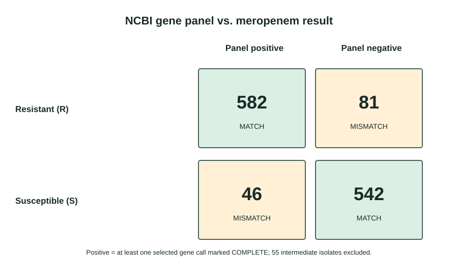

# Meropenem phenotype and resistance-gene annotations in *Klebsiella pneumoniae*
**Skills used:** Python, pandas, NCBI Pathogen Detection, AMRFinderPlus, reproducible workflows
This beginner project compares laboratory antimicrobial susceptibility test (AST) results with NCBI AMRFinderPlus annotations for the **same bacterial isolate**. It asks how often a selected gene panel agrees with the submitted meropenem result in this downloaded public dataset.

> This is an exploratory analysis of public records. It is not a clinical test evaluation and must not be used to guide treatment.

## Main result

The NCBI export downloaded on 17 October 2026 contained 1,306 clinical records: 663 resistant (R), 588 susceptible (S), and 55 intermediate (I). The R/S comparison used 1,251 records and set the intermediate group aside.

Panel-positive means at least one selected `blaKPC`, `blaNDM`, or selected OXA-48-like gene call was marked `COMPLETE` by NCBI.

| Submitted meropenem result | Panel positive | Panel negative | Total |
|---|---:|---:|---:|
| Resistant (R) | 582 | 81 | 663 |
| Susceptible (S) | 46 | 542 | 588 |



The categories agreed for 1,124 of 1,251 records (89.8%). That percentage describes this dataset, not the performance of a clinical test. The browser showed 436 SNP clusters, and the reported Wilson confidence intervals do not adjust for related isolates.

## What is included

- [Beginner walkthrough](outputs/BEGINNER_GUIDE.md)
- [Full results and limitations](outputs/RESULTS_SUMMARY.md)
- [Cohort and source notes](outputs/COHORT_FEASIBILITY.md)
- [SVG figure](outputs/figures/panel_vs_meropenem.svg)
- [Jupyter notebook for a polished PNG/SVG figure](outputs/plot_results_in_jupyter.ipynb)
- Reproducible Python scripts in `outputs/scripts/`

## Data and reproducibility

The raw NCBI metadata CSV is not included in this repository. Download the metadata from the [NCBI Pathogen Detection Isolates Browser](https://www.ncbi.nlm.nih.gov/pathogens/isolates/) using this query, then save it as `work/data/raw/isolates.csv`:

```text
taxgroup_name:"Klebsiella pneumoniae" AND epi_type:clinical AND (AST_phenotypes:meropenem=R OR AST_phenotypes:meropenem=S OR AST_phenotypes:meropenem=I) AND AMR_genotypes:*
```

This query and export were recorded on 17 October 2026; NCBI's data may change. The scripts create intermediate CSVs under `work/`, which is excluded from Git by `.gitignore`.

Requirements: Python 3.9+, pandas, and (for the notebook figure) matplotlib. From the project root on Windows, a fresh environment can be created with:

```powershell
python -m venv .venv
.\.venv\Scripts\python.exe -m pip install -r requirements.txt
```

Then run the scripts from the project root in this order:

```powershell
.\.venv\Scripts\python.exe outputs/scripts/01_audit_metadata.py
.\.venv\Scripts\python.exe outputs/scripts/02_prepare_analysis_table.py
.\.venv\Scripts\python.exe outputs/scripts/03_flag_carbapenemase_genes.py
.\.venv\Scripts\python.exe outputs/scripts/04_review_gene_call_status.py
.\.venv\Scripts\python.exe outputs/scripts/05_compare_panel_with_meropenem.py
.\.venv\Scripts\python.exe outputs/scripts/06_review_discordant_isolates.py
.\.venv\Scripts\python.exe outputs/scripts/08_compare_gene_families.py
.\.venv\Scripts\python.exe outputs/scripts/07_make_results_figure.py
```

## Limitations

Public isolates are selected rather than a random sample. AST methods and metadata can vary. A gene annotation does not prove expression or explain an individual AST result; the selected gene panel is incomplete. The 436 SNP clusters suggest that some records may be related, but the confidence intervals do not account for that. See the full [results summary](outputs/RESULTS_SUMMARY.md) before interpreting the estimates.
